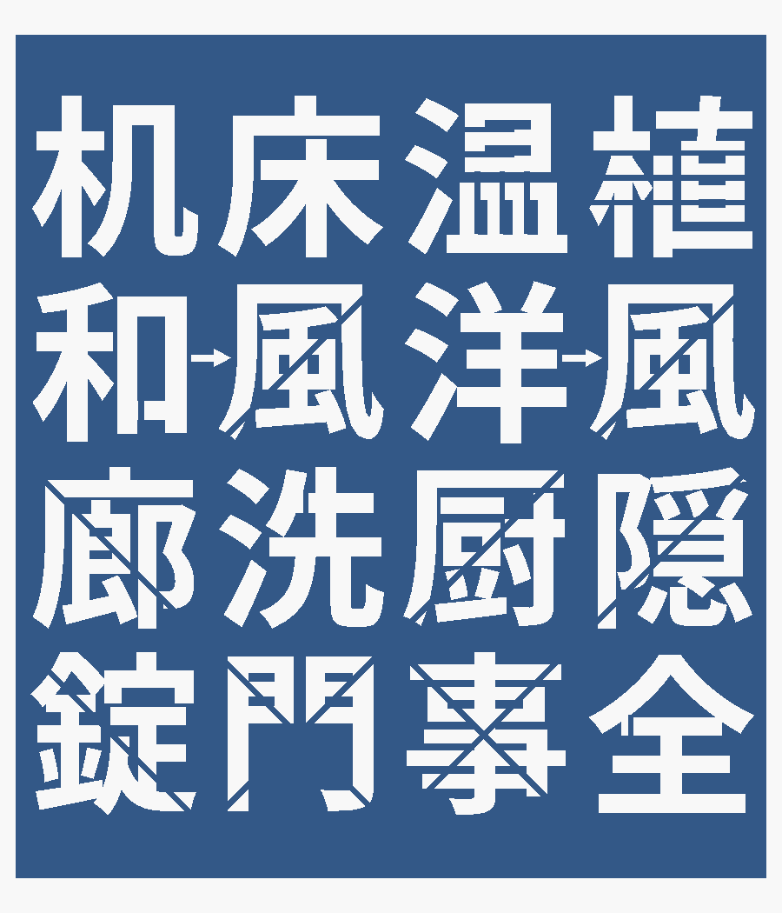

# SMC-PAD × Home Assistant

Bluetooth MIDI パッド **M-VAVE SMC-PAD** を、Home Assistant の物理リモコンにします。

- 16 パッド × 2 ページ = 32 ボタン、8 ノブ × 2 バンク = 16 ノブ
- パッドを押すと HA のイベントが飛び、自動化で照明・家電・鍵を操作
- ノブで明るさ・風量を調整。**回す向きと明るさの向きが必ず一致する**工夫入り
- 3D プリントの漢字ラベル（パッド用）と 2 色刷りのノブ用ラベル板の STL / SCAD 付き



## 仕組み

```
SMC-PAD ──BLE MIDI──▶ Raspberry Pi（SMC-PAD.sh + midi.py）──HTTP──▶ Home Assistant
                                                          イベント smc_pad_event
```

- `SMC-PAD.sh`: bluetoothctl でスキャン → trust → connect → midi.py を起動。切れたら最初からやり直す
- `midi.py`: MIDI を受けて HA のイベント API（`POST /api/events/smc_pad_event`）に送る
  - 送る中身: `{"type": "note_on" | "control_change", "note": <Note または CC 番号>, "value": <値>}`
  - ノブは間引き（回し始めは即送信、その後 0.25 秒ごとに最新値、最後の値は必ず送る）
  - ノブは「HA の今の明るさを起点に、回した分だけ動かす」方式（下記）
  - Flask で `:5001/set_led` を開き、HA からパッドの LED を制御できる（任意）

## セットアップ（Raspberry Pi OS で確認）

### 1. SMC-PAD を Bluetooth でペアリング

SMC-PAD の電源を入れてから実行します。

```bash
bluetoothctl --timeout 5 scan on > /dev/null 2>&1 && bluetoothctl devices   # 「SMC-PAD」の MAC を探す
bluetoothctl pair    XX:XX:XX:XX:XX:XX
bluetoothctl trust   XX:XX:XX:XX:XX:XX
bluetoothctl connect XX:XX:XX:XX:XX:XX   # Connection successful ならOK
```

### 2. 必要なソフトを入れる

```bash
sudo apt update
sudo apt install -y python3-rtmidi libasound2-dev
pip3 install mido python-rtmidi requests flask --break-system-packages
git clone https://github.com/bey-jp/smc-pad-ha.git
cd smc-pad-ha
```

### 3. ボタン番号を確認する（`test_midi.py`）

```bash
python3 test_midi.py
```

パッドを押すと `MIDI受信: note_on channel=0 note=104 velocity=127` のように表示されます。
ポート一覧に `SMC-PAD:SMC-PAD Bluetooth` が出ない場合は、1 の `connect` からやり直します。

### 4. Home Assistant の長期アクセストークンを作る

HA の左下のユーザー名 → **セキュリティ** → **長期有効アクセストークン** → 「トークンを作成」。表示された文字列は一度しか見られないので控えておきます。

### 5. `midi.py` と `SMC-PAD.sh` を書き換える

- `midi.py` の `HA_URL`（例 `http://192.168.0.10:8123`）と `HA_TOKEN`（4 のトークン）
- `midi.py` の `KNOB_SOURCE`（ノブで動かすライトの entity_id。ノブを使わないなら空でよい）
- `SMC-PAD.sh` の `MAC_ADDR`（1 で調べた MAC）

動作確認: `bash SMC-PAD.sh` → パッドを押すとログに `[HA送信成功] Type: note_on, Note/CC: 104, Val: 40` のように出ます。

### 6. 起動時に自動で動かす（systemd）

`systemd/smc-pad.service` の `User` と、`WorkingDirectory` / `ExecStart` のパスを自分の環境に直して:

```bash
sudo cp systemd/smc-pad.service /etc/systemd/system/
sudo systemctl daemon-reload
sudo systemctl enable --now smc-pad.service
systemctl status smc-pad.service      # active (running) ならOK
journalctl -u smc-pad.service -f      # ログを見る
```

`SMC-PAD.sh` は「探す → つなぐ → midi.py を起動」を繰り返すので、SMC-PAD の電源を切っても、入れ直せば自動でつながります。

### 7. Home Assistant の自動化を作る

ボタン 1 個につき自動化を 1 つ作ります（`automations_example.yaml` に実例。鍵のトグル、ノブで明るさ・色温度・風量）。基本形:

```yaml
triggers:
  - trigger: event
    event_type: smc_pad_event
    event_data: {type: note_on, note: 104}
actions:
  - action: light.toggle
    target: {entity_id: light.hallway}
```

UI で作る場合: 自動化 → 新規 → トリガー「手動イベント」→ イベントタイプ `smc_pad_event`、イベントデータ `type: note_on` と `note: 104`。

### 8. パッドの色（任意）

パッドのバックライトの色は、M-VAVE の専用アプリ **MidiSuite** でパッドごとに設定します（本体に保存されます）。
`midi.py` には HA から LED を送る `:5001/set_led` もありますが、筆者の個体では HA からの色変更は確認できていません。

## ボタン番号（筆者の個体で実測）

| | 通常 | BANK ボタン ON |
|---|---|---|
| パッド | Note 100〜115 | Note 52〜67（PAD BANK） |
| ノブ 1〜8 | CC 30〜37 | CC 38〜45（KNOB BANK） |

パッドの並び（上段から）: `112-115 / 108-111 / 104-107 / 100-103`。ファームや設定で番号が違う場合があります。

## ノブの工夫

SMC-PAD のノブは本体が 0〜127 の「位置」を覚えていて、外から書き換えられません。
そのままだと「100% で点いているライトを、位置 10 のノブで右に回すと 1% に暗くなる」ことが起きます。

`midi.py` は回し始めに HA から今の明るさを読み、

- 右回し: 「ノブ位置〜127」を「今の明るさ〜最大」に割り当て
- 左回し: 「ノブ位置〜0」を「今の明るさ〜消灯」に割り当て

として送ります。どこから回しても、右に回せば明るく、左に回せば暗くなり、端まで必ず届きます。
明るさは HA 側で 2 乗カーブ `(値/127)^2 × 100 %` にしています（`automations_example.yaml`）。

## 3D プリントのラベル

STL / SCAD はすべて [`overlay/`](overlay/) フォルダに入っています。

| ファイル | 内容 |
|---|---|
| [`overlay/pad_plate_full_v6_t3.5.stl`](overlay/pad_plate_full_v6_t3.5.stl) | パッド 16 個用の漢字ラベル（筆者の字入り。131×147mm、厚み 3.5mm）。文字は貫通穴で、パッドの LED が透ける |
| [`overlay/knob_plate_inlay.stl`](overlay/knob_plate_inlay.stl) | ノブ用ラベル板（筆者の字入り。57×147mm、厚み 2.8mm）。単色プリンターで 2 色刷り |
| [`overlay/pad_plate_blank_t3.5.stl`](overlay/pad_plate_blank_t3.5.stl) | **無地のパッド板**（字なし）。好きな字を入れる用 |
| [`overlay/knob_plate_blank.stl`](overlay/knob_plate_blank.stl) | **無地のノブ板**（穴と目盛りだけ）。好きな字を入れる用 |
| `overlay/pad_plate_full_v6.scad` / `overlay/knob_plate.scad` | 上の STL の元データ（OpenSCAD） |
| [`overlay/custom_from_blank.scad`](overlay/custom_from_blank.scad) | 無地の STL に好きな字を入れる OpenSCAD ファイル（下の方法 A） |
| `overlay/bridge.py` | 「口」「田」のような閉じた部分が抜け落ちないよう、ブリッジ（つなぎ線）を探す補助スクリプト |

Tinkercad でも公開しています（そのまま改造できます）:
[パッド](https://www.tinkercad.com/things/0eFnhjktVFl-smc-pad-pad) /
[ノブ](https://www.tinkercad.com/things/gt6rj3dHdYj-smc-pad-knob) /
[壁掛けスタンド](https://www.tinkercad.com/things/c3DjnvHw79C-smc-pad-stand)

寸法は筆者の SMC-PAD の実測値です。

### 好きな字に変える

**方法 A: 無地の STL に字を入れる（いちばん手軽）**

[`overlay/custom_from_blank.scad`](overlay/custom_from_blank.scad) は、無地の STL を読み込んで字の形をくり抜くだけの短いファイルです。

1. `custom_from_blank.scad` と、無地の STL（`pad_plate_blank_t3.5.stl` / `knob_plate_blank.stl`）を同じフォルダに置いて OpenSCAD で開く
2. `part` を `"pad"`（パッド板）か `"knob"`（ノブ板）にする
3. `pad_labels`（上の段から 4 文字ずつ）または `knob_labels`（ノブ 1〜8 の順）の字を書き換える。字の無い所は `""`
4. 囲まれた部分がある字は `bridges` につなぎ線を足す（まず斜め 1 本 `[[45, 0]]`、ダメならバッテン `[[45, 0], [-45, 0]]`）
5. F6（レンダリング）→ F7（STL を書き出す）

パッド板の字は板を貫通する穴になり、ノブ板の字は表から 0.6mm 彫り込まれます（2 色刷り用）。
中身の字のままで書き出すと、筆者の板と同じものになります（矢印を除く）。


Tinkercad などほかのソフトで字を入れる場合: パッドの中心は、板の中心を原点として X・Y とも −48.6 / −16.2 / +16.2 / +48.6 mm（パッドは約 30.9mm 角、字は 20mm 前後が目安）。ソフトによっては日本語が入らないことがあります。

**方法 B: 元の SCAD を書き換える（寸法や矢印まで変えたい人向け）**

1. [OpenSCAD](https://github.com/openscad/openscad/releases)（2026.11-RC0 で確認）と、フォント Noto Sans CJK JP Bold（[notofonts/noto-cjk](https://github.com/notofonts/noto-cjk) の `NotoSansCJK-Bold.ttc`）を入れる
2. パッド板: `pad_plate_full_v6.scad` の `grid_labels` を書き換える（上の段から 4 文字ずつ。`"◯"` は空欄、矢印が要らなければ `arrow_on = false`）
   ```
   grid_labels = [
     ["机", "床", "温", "植"],
     ["和", "風", "洋", "風"],
     ["廊", "洗", "厨", "隠"],
     ["錠", "門", "事", "全"],
   ];
   ```
3. ノブ板: `knob_plate.scad` の `labels` の 1 つ目の字を書き換える（並びは 下段左=1, 下段右=2, … 上段右=8）
4. F6（レンダリング）→ F7（STL を書き出す）
5. 「口」「田」「回」のように**囲まれた部分がある字は、中が抜け落ちます**。`bridge_table` につなぎ線を足します（例: `["錠", [[-45,0]]]` は斜め 1 本）。細かすぎる字（「鍵」など）は潰れるので、簡単な字を選ぶのがコツです

### 印刷のコツ

- パッド板: 字は貫通穴なので、光を通さない色で印刷すると字だけが光ります（筆者は TPU を想定して設計）
- ノブ板の 2 色刷り（Creality K1C で確認）: 字の面を下にして、0.2mm 積層で印刷。0.8mm の層の前で一時停止して黒→白、1.6mm の層の前で一時停止して白→黒
- 字は実寸 10mm 以上に。4〜6mm の字は潰れました

## 注意

- 鍵や 3D プリンターの電源など、遠隔操作するものは十分注意してください。自己責任でご利用ください。

## ライセンス

- このリポジトリのコードと 3D データ: MIT License（`LICENSE`）
- フォント（Noto Sans CJK JP）は同梱していません（SIL Open Font License）

紹介記事: https://bey.jp/?p=119506
